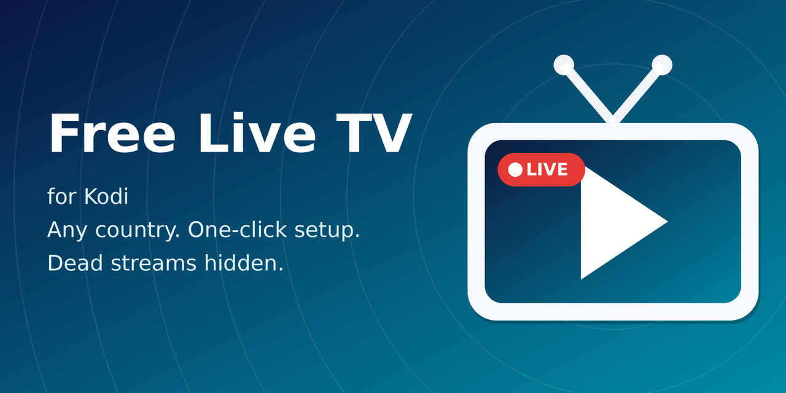
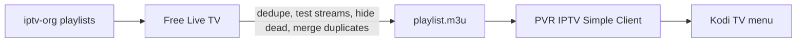

<p align="center">
  
</p>

<p align="center">
  <a href="https://github.com/Shariqtechie/kodi-livetv-free/releases/latest"></a>
  <a href="https://github.com/Shariqtechie/kodi-livetv-free/stargazers"></a>
  
  <a href="LICENSE"></a>
</p>

<h3 align="center">Free live TV from any country in Kodi. Pick your country, press OK, done.</h3>

<p align="center">
  Open source &bull; no accounts &bull; no ads &bull; updates itself &bull; maintained in the open
</p>

---

## Why this exists

Kodi can play free public IPTV streams, but getting there by hand is a chore: install a PVR client, find the right playlist URL, paste it in, fiddle with settings, and then half the channels turn out to be dead.

**Free Live TV does all of that for you.** It pulls the community-maintained [iptv-org](https://github.com/iptv-org/iptv) playlists, cleans them up, tests which streams actually answer, and wires everything into Kodi's built-in TV menu.

| | Doing it by hand | Free Live TV |
|---|---|---|
| Install PVR IPTV Simple Client | Manual | Automatic |
| Configure the playlist | Copy URLs, edit settings | One prompt: pick your country |
| Dead channels | Click through them one by one | Tested and hidden for you |
| Same channel listed 5 times | Scroll past them | Best working stream kept |
| Keep it up to date | You remember to | Refreshes itself, updates through Kodi |
| Something broke | Dig through `kodi.log` | One-click diagnostic export |

> **Real numbers:** when we tested India's list (772 channels), **83 streams (11%) were dead**: timeouts, 404s, DNS failures. Free Live TV found and hid them in 45 seconds.

## Features

- **One-click setup.** First launch asks for your country (India is preselected, just press OK) and configures everything.
- **Every country iptv-org covers**, plus an "All countries" option. Switch any time from the add-on settings.
- **Dead-stream testing.** *Test channels now* checks every stream in parallel, remembers the results, and hides what doesn't work. Streams that come back to life return automatically on the next test.
- **Duplicate merging.** If a channel is listed several times, only the best one stays: a stream known to work first, then the highest resolution.
- **Auto-updates.** Install the repository once and Kodi keeps the add-on current. The playlist itself refreshes on a schedule you control.
- **Built-in troubleshooting.** A debug log, a log viewer, and an export that bundles diagnostics with the relevant lines of `kodi.log`, ready to paste into an issue.
- **Safe by design.** Only touches its own IPTV Simple instance. Your existing PVR setup is left alone.

<!-- Add your own screenshots here, then delete this comment:
<p align="center">
   
</p>
-->

## Install

**Requires Kodi 21 (Omega).** Tested and working on **Windows, Android TV and Android phones**. Kodi 20.8+ should work too. Linux, macOS and Raspberry Pi/LibreELEC haven't been tried yet, so reports are welcome.

1. In Kodi go to **Settings → File manager → Add source** and enter:
   ```
   https://shariqtechie.github.io/kodi-livetv-free/
   ```
   Name it `freelivetv`.
2. Go to **Settings → Add-ons → Install from zip file → freelivetv** and pick `repository.freelivetv-1.0.0.zip`.
3. Go to **Install from repository → Free Live TV Repository** and install **Free Live TV**.
4. Wait a few seconds. A country picker appears. Press **OK** for India or choose your own, accept the PVR IPTV Simple Client install, and say yes to the channel test.
5. Open **TV** on the Kodi home screen. That's it.

> **If Kodi shows an error or crashes while PVR IPTV Simple Client is being installed** (it happens occasionally, and it's Kodi rather than this add-on), don't worry. Restart Kodi, open **Add-ons → My add-ons → Services → Free Live TV → Configure**, go to the **Tools** tab and press **Set up / repair Live TV now**. That finishes the setup.

> You can also grab the zips from the [Releases page](https://github.com/Shariqtechie/kodi-livetv-free/releases).

## How it works



Free Live TV is a small Kodi service add-on written in Python. It downloads the playlist for your country, filters it, writes a clean `playlist.m3u` into its own profile folder, and points its own instance of PVR IPTV Simple Client at that file. Kodi's native TV interface does the rest. The add-on hosts no streams and no content.

## Settings

| Setting | What it does |
|---|---|
| **Country code / Pick from list** | Which country's channels to load. Use `all` for everything. |
| **Remove duplicate streams** | Drops repeated URLs and sorts by name. |
| **Hide dead channels** | Leaves out streams that failed the last test. Untested channels are kept. |
| **Merge duplicate channels** | Keeps the best stream per channel. |
| **Re-test channels after (days)** | How long a test result stays fresh. |
| **Refresh playlist every (hours)** | How often the list is re-downloaded. |
| **Set up / repair Live TV now** | Installs PVR IPTV Simple Client if it's missing and re-applies the configuration. Use it if setup was interrupted or TV looks empty. |
| **Refresh playlist now** | Re-downloads the channel list immediately. |
| **Test channels now** | Runs the stream test. Takes about a minute for one country. |
| **Debug logging / View / Export log** | Everything you need to report a problem. |

## FAQ

**Some channels won't play. Is it broken?**
Public streams come and go, and some are blocked outside their home country. Run **Test channels now** to hide the dead ones. A stream's playlist can answer and still buffer, because the test checks reachability, not picture quality. A deeper playback check is on the roadmap.

**Does it have a TV guide (EPG)?**
Not yet. Reliable free guide data is hard to come by, so it's on the roadmap as an optional feature rather than a default.

**Is this legal?**
The add-on hosts no content. It only links to publicly available streams listed by the iptv-org project, and availability and licensing vary by country and by channel. You're responsible for how you use it.

**Which devices does it work on?**
Tested and working on Windows, Android TV and Android phones. It's plain Python on top of PVR IPTV Simple Client, so Linux, macOS and Raspberry Pi/LibreELEC should work too, but nobody has confirmed that yet. If you try one, [tell us how it went](https://github.com/Shariqtechie/kodi-livetv-free/issues).

**Setup errored or Kodi crashed while installing the PVR client. What now?**
Restart Kodi, open the add-on's settings and press **Set up / repair Live TV now** (Tools tab). It picks up where setup stopped.

**It broke. What do I send you?**
Open the add-on settings → **Troubleshooting → Export log to folder**, then attach the file to a [new issue](https://github.com/Shariqtechie/kodi-livetv-free/issues/new/choose). It contains versions, settings and the relevant log lines, and nothing personal beyond file paths.

## Roadmap

- [x] One-click setup with country picker
- [x] Every iptv-org country
- [x] Stream testing with result cache
- [x] Duplicate merging
- [x] Built-in diagnostics and log export
- [ ] Deeper playback check (download a few seconds of video, measure speed)
- [ ] Browse by category and language, not just country
- [ ] Optional EPG (bring your own XMLTV URL)
- [ ] Translations
- [x] Verified on Windows, Android TV and Android phones
- [ ] Verified on Linux, macOS and Raspberry Pi/LibreELEC

Ideas and pull requests are welcome. Good first issues are labelled as such.

## Contributing

1. Fork, make your change, test it in Kodi.
2. Run `python3 scripts/build_repo.py --out site --base-url https://example.com/` to make sure the repo still builds.
3. Open a pull request describing what changed and how you tested it.

Maintainers release with `scripts/release.sh X.Y.Z`. GitHub Actions builds and publishes the repository, so installed copies update automatically.

## Credits

- [**iptv-org**](https://github.com/iptv-org/iptv) and its contributors maintain the playlists this add-on is built on. This project is independent and not affiliated with them.
- The IPTV Simple instance-settings technique is adapted from the [JioTV Direct add-on](https://github.com/dineshintry/plugin.kodi.jiotv) (MIT).
- [PVR IPTV Simple Client](https://github.com/kodi-pvr/pvr.iptvsimple) by the Kodi team does the heavy lifting.

## Disclaimer

This software is provided as is, with no warranty. It does not host, store or distribute any streams. All trademarks and channel names belong to their respective owners.

---

<p align="center">
  <b>If Free Live TV saved you time, a ⭐ helps other Kodi users find it.</b>
</p>
